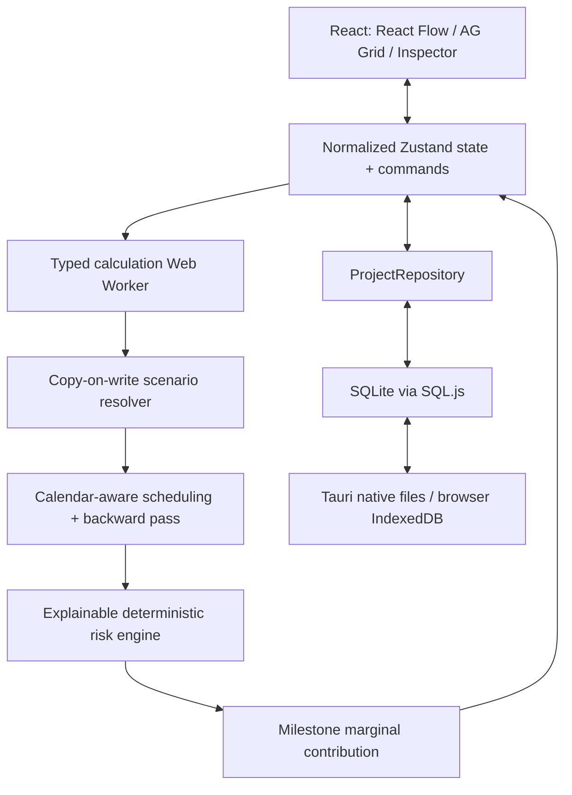

# Architecture

Project Risk Planner is a local-first schedule digital twin, not a resource planner.
The same pure engines power the desktop app and automated tests.

`packages/domain`, `scheduling`, `risk`, and `scenarios` contain no UI or persistence dependencies.
`packages/persistence` owns SQLite schema, transactions, import validation and repository contracts.
The desktop shell is Tauri 2. SQLite runs locally through SQL.js (the same SQLite file format on
desktop and browser); Tauri provides native file dialogs and atomic file replacement.
Browser development uses IndexedDB for durability, not an external server.

Forward dates are cached by input signatures and propagated invalidation. Global latest dates,
slack and risk are recomputed because a changed completion or target can affect ancestors and
other terminal branches. Contributor counterfactuals share precomputed schedule-dependent edge
factors and recalculate only affected downstream exposures. Results carry engine versions and
scenario identity and are saved separately from input.

All document mutations use validated reversible commands. Invalid commands do not enter history.
Worker request IDs and document revisions prevent stale asynchronous results from replacing newer data.
Errors are displayed locally; there is no telemetry or network dependency at runtime.
